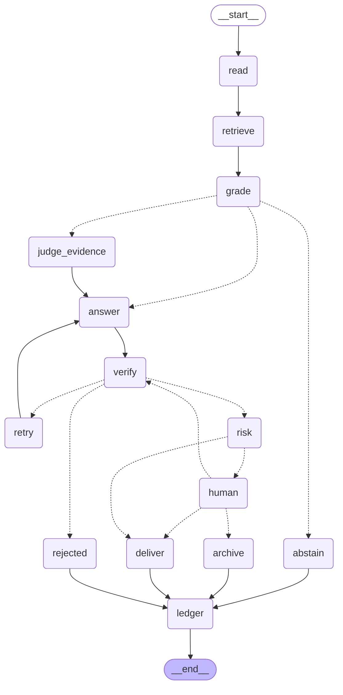

# 14 · `answer_graph` v0: lo construido, el diagrama real y una limitación conocida

Primera implementación del grafo 1 de `09-agents.md` (`answer_graph`), corriendo de punta a punta contra
`data/corpus_v0` real. Vive en `backend/regulabank/agents/`; 62 tests en `backend/tests/` (`pytest`).

## Qué está construido vs. qué es un reemplazo temporal

| Pieza | Estado | Archivo |
|---|---|---|
| `read` (escenario + pesos de canal) | **real**, por regex | `agents/route.py` |
| `grade` (confianza: categoría + número) | **real**, con umbrales en `seeds/params.toml` | `agents/grade.py` |
| `verify` (cita literal, vigencia, números ajenos, lenguaje) | **real**, código puro | `agents/verify.py` |
| `risk` (tabla de reglas) | **real**, `seeds/risk_rules.csv` | `agents/risk.py` |
| `ledger` (una línea por consulta) | **real**, JSONL append-only | `agents/ledger.py` |
| El grafo (`StateGraph`, bucle de reintento, `interrupt` humano) | **real** | `agents/graph.py` |
| `retrieve` | **mixto**: lexical simple (solape de palabras, *provisional*, sustituto del denso) **+** entidades estructuradas (*real*, regex), fundidos por RRF — sin embeddings ni grafo de relaciones todavía | `agents/retrieve_stub.py`, `agents/entities.py`, `agents/fuse.py` |
| `answer` / `judge_evidence` (el modelo) | **provisional**: `FakeProvider` guionado, sin LLM real | `agents/providers.py` |

`retrieve_stub` y `FakeProvider` se reemplazan sin tocar ningún otro nodo del grafo: la forma de salida
(`list[Hit]`, `Answer`) no cambia, solo cómo se llena. Son intencionalmente los únicos dos componentes que
dependen de un modelo entrenado.

## Cómo puntúa `retrieve` hoy: dos señales, no una

Ranking simple, sin PPR ni fusión de 5 canales: **semántico** (hoy, lexical; mañana, denso) + **entidades**
(`norm_ref`, `article_ref`, `deadline`, `amount`, `percentage` — regex, sin modelo, `docs/04-entities.md`).
Las relaciones del grafo (`REFERS_TO`, `MODIFIES`, `IMPLEMENTS`) **no entran al ranking**: quedan para que el
modelo las pida como herramienta en `judge_evidence`/`answer` cuando el escenario las necesite (`crossref`,
`impact`, `policy_vs_norm`) — eso todavía no está implementado, es el siguiente paso natural.

Un detalle importante que surgió probándolo: **RRF puntúa por rango, no por magnitud.** Si se usara el score
fundido de RRF directamente como "confianza", una pregunta sin ninguna relación real con el corpus podía
sacar el mismo número que una con una coincidencia fuerte, porque RRF solo sabe que algo quedó primero en su
canal, no cuán bueno es ese primer lugar. Por eso `Hit.score` (lo que lee `grade` para medir confianza) es la
**magnitud cruda** del mejor canal — lexical o entidad, el que sea más alto —, y RRF se usa *solo* para decidir
el orden final de los 8, no el número que se reporta.

Las dos señales son independientes: una coincidencia exacta de entidad (mismo tipo y mismo valor, p. ej. el
mismo número de norma) alcanza por sí sola para subir la confianza, igual que un buen solape léxico, sin que
haga falta la otra. Ejemplo real, probado contra `data/corpus_v0`:

| Pregunta | Confianza (`grade.score`) | Resultado |
|---|---|---|
| *"¿cuál es el componente procíclico?"* | 0.05 | `no_evidence` |
| *"¿cuál es el componente procíclico **de la Res. SBS 11356-2008**?"* | 0.38 | `ok` |

Nombrar la norma exacta rescata la confianza aunque el solape de palabras sea flojo — ese es el punto del
canal de entidades.

## Limitación conocida (encontrada probándolo, no teórica)

`FakeProvider.answer()` es deliberadamente simple: toma la primera oración del mejor `Hit` como cita. Cuando el
`retrieve_stub` (lexical puro, sin IDF) devuelve como "mejor" un chunk con ruido de extracción del PDF —por
ejemplo un número de página o un fragmento de encabezado suelto—, la cita sale literal (pasa `verify`, porque
de verdad está en el chunk) pero no es útil. Se vio en vivo con la pregunta *"¿Cuál es el plazo máximo para
remitir el reporte de operaciones sospechosas?"*:

```
escenario=threshold grade=label='ambiguous' score=0.1124 risk=notify
cita [c_d66199ad59ac5502]: '19\nR.'
```

No es un bug de `verify` ni del grafo: ambos componentes involucrados (`retrieve_stub`, `FakeProvider`) son
placeholders declarados como tales. Pero es la prueba concreta de por qué el retrieval real (denso + BM25 +
PPR, `08-retrieval.md`) y un proveedor real importan antes de confiar en esto para una demo — el síntoma
desaparece con mejor retrieval (el chunk ya no sería "el mejor") y con un proveedor que redacte de verdad en
vez de recortar la primera oración.

## El grafo, generado por código (`draw_mermaid()`, no dibujado a mano)

Según el principio ya fijado en `09-agents.md` ("`draw_mermaid()` genera el diagrama; no se dibuja a mano"),
esto es la salida real de `build_answer_graph(FakeProvider()).get_graph().draw_mermaid()` sobre el grafo tal
como está compilado hoy — no una ilustración aparte que se pueda desincronizar del código:



Líneas punteadas = rama condicional (`add_conditional_edges`); líneas sólidas = paso fijo. Para regenerarlo
tras cambiar el grafo:

```python
from regulabank.agents.graph import build_answer_graph
from regulabank.agents.providers import FakeProvider

print(build_answer_graph(FakeProvider()).get_graph().draw_mermaid())
```

## Quién decide en cada nodo (igual que `09-agents.md`, confirmado contra la implementación)

| Nodo | Quién decide | Archivo |
|---|---|---|
| `read` | código (regex) | `route.py` |
| `retrieve` | código (lexical provisional + entidades real, fundidos por RRF) | `retrieve_stub.py`, `entities.py`, `fuse.py` |
| `grade` | código (umbrales calibrables) | `grade.py` |
| `judge_evidence` | modelo (`FakeProvider`, luego el real) | `providers.py` |
| `answer` | modelo | `providers.py` |
| `verify` | código — único lugar que puede rechazar una cita | `verify.py` |
| `risk` | código (tabla) — el modelo nunca baja el riesgo que fija la regla | `risk.py` |
| `human` | persona, vía `interrupt()` | `graph.py` |
| `ledger` | código, append-only | `ledger.py` |

## Cómo probarlo sin esperar al transformer

```bash
cd backend
python -m pytest tests/ -v              # 62 tests, todos contra data/corpus_v0 real
python scripts/demo_answer_graph.py      # corre 3 preguntas de ejemplo y muestra el grafo completo
```

El endpoint `POST /answer` (`api/app.py`) ya corre este grafo en vez de las respuestas guionadas de `mock.py`.
